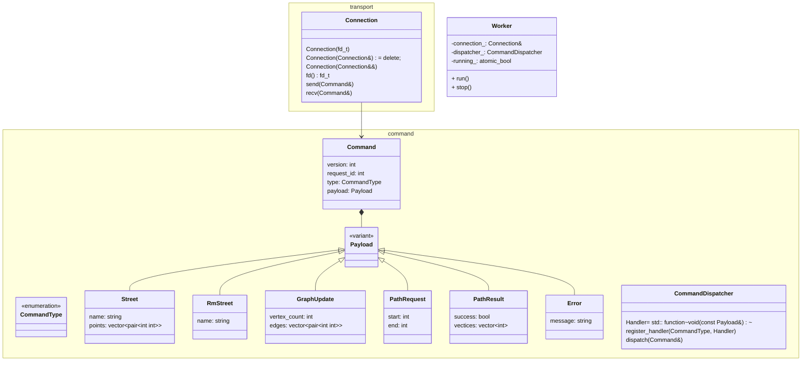
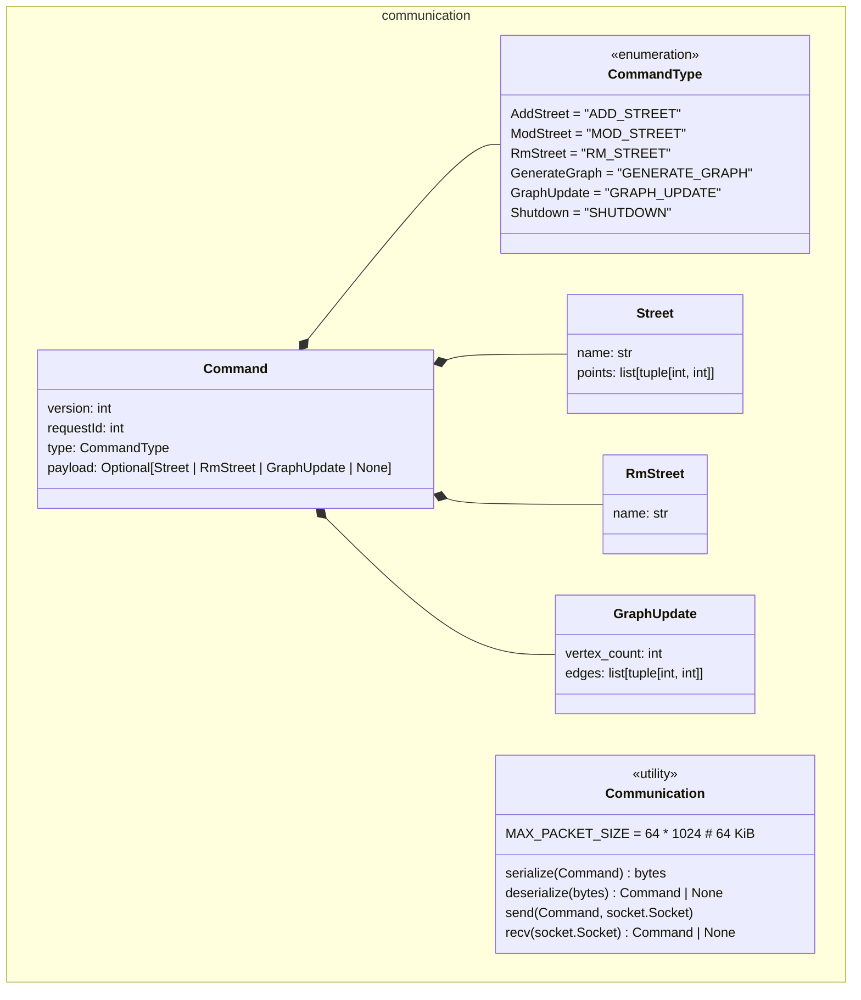
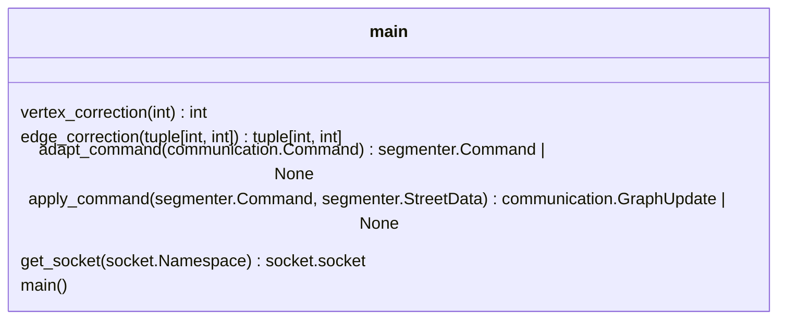
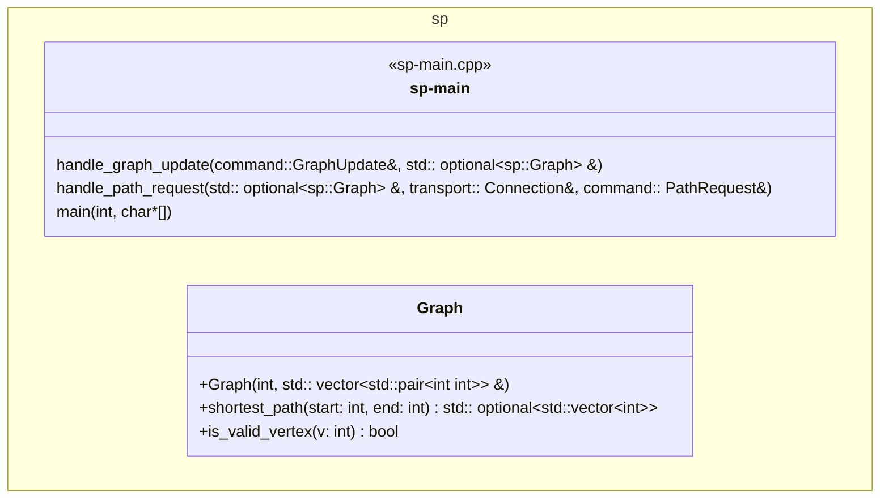
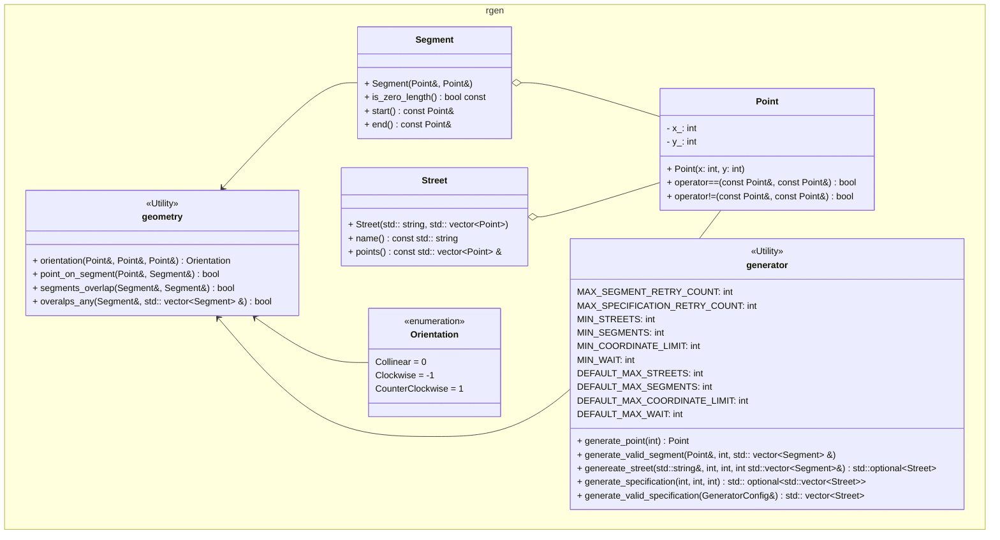

\page a4 A4

# A4

## General Structure

The project is structured into the following programs:

- `driver`: The main program that initializes the simulation and manages the communication between the different
  processes.
- `sp`: The process responsible for handling graph updates and generating the shortest paths between 2 points.
- `py`: Responsible for handling streets data and generating graphs.
- `rgen`: Responsible for simulating streets generation.

## Classes

This project is structured under the following classes



**Py**

```mermaid
classDiagram
    namespace segmenter {
        class CommandOperation {
            <<enumeration>>
            ADD
            MOD
            RM
            GG
        }
        class Command {
            +CommandOperation operation
            +str name
            +list coordinates
            +street() Street
        }

        class Street {
            +str name
            +list coordinates
            +segments() list~Segment~
        }

        class Segment {
            +tuple start
            +tuple end
            +Street street
        }

        class Intersection {
            +tuple point
            +Segment segment_1
            +Segment segment_2
        }

        class StreetData {
            +dict streets
            +add(street) void
            +mod(street) void
            +rm(street_name) void
            +gen() Graph
        }

        class Graph {
            +dict vertices
            +set edges
            +add_vertex(point) int
            +get_vertex_id(point) int
            +add_edge(a, b) void
        }
    }

    Command --> CommandOperation
    Command ..> Street
    Street "1" *-- "0..*" Segment
    Intersection --> "1" Segment
    StreetData ..> Graph
StreetData o-- "0..*" Street
```







**short-path**



**r-gen**



## Communication

The different processes communicate via IPC sockets, by sending different commands.


[//]: # (https://www.slideserve.com/ginger-olsen/sockets)

These commands are serialized into JSON and sent via sockets. These sockets have `AF_UNIX` domain and their type is
`SOCK_SEQPACKET`. Using `SOCK_SEQPACKET` ensures that messages are delivered in the order they are sent and that the
entire message is received, which is crucial for maintaining the integrity of the communication protocol in this
context.

The general C++ structure is:

```c++
enum class CommandType {
    None,
    AddStreet,
    ModStreet,
    RmStreet,
    GenerateGraph,
    GraphUpdate,
    PathRequest,
    PathResult,
    Error,
    Shutdown,
    Ack,
};

struct AddStreet {
    std::string name;
    std::vector<std::pair<int, int>> points;
};

struct ModStreet {
    std::string name;
    std::vector<std::pair<int, int>> points;
};

struct RmStreet {
    std::string name;
};

struct GraphUpdate {
    std::vector<int> vertices;
    std::vector<std::pair< int, int>> edges;
};

struct PathRequest {
    int start;
    int end;
};

struct PathResult {
    bool success = false;
    std::vector<int> vertices;
};

using Payload = std::
        variant<std::monostate, AddStreet, ModStreet, RmStreet, GraphUpdate, PathRequest, PathResult>;

struct Command {
    unsigned int version;
    unsigned int request_id;
    CommandType type;
    Payload payload;
};
```

The JSON format can be seen as

```json
{
  "$schema": "https://json-schema.org/draft/2020-12/schema",
  "title": "Command",
  "type": "object",
  "required": [
    "version",
    "request_id",
    "type",
    "payload"
  ],
  "properties": {
    "version": {
      "type": "integer",
      "minimum": 0
    },
    "request_id": {
      "type": "integer",
      "minimum": 0
    },
    "type": {
      "type": "string",
      "enum": [
        "NONE",
        "ADDSTREET",
        "MODSTREET",
        "RMSTREET",
        "GENERATEGRAPH",
        "GRAPHUPDATE",
        "PATHREQUEST",
        "PATHRESULT",
        "ERROR",
        "SHUTDOWN",
        "ACK"
      ]
    },
    "payload": {
      "oneOf": [
        {
          "type": "null"
        },
        {
          "type": "object",
          "required": [
            "name",
            "points"
          ],
          "properties": {
            "name": {
              "type": "string"
            },
            "points": {
              "type": "array",
              "items": {
                "type": "array",
                "items": {
                  "type": "integer"
                },
                "minItems": 2,
                "maxItems": 2
              }
            }
          }
        },
        {
          "type": "object",
          "required": [
            "name"
          ],
          "properties": {
            "name": {
              "type": "string"
            }
          }
        },
        {
          "type": "object",
          "required": [
            "vertices",
            "edges"
          ],
          "properties": {
            "vertices": {
              "type": "array",
              "items": {
                "type": "integer"
              }
            },
            "edges": {
              "type": "array",
              "items": {
                "type": "array",
                "items": {
                  "type": "integer"
                },
                "minItems": 2,
                "maxItems": 2
              }
            }
          }
        },
        {
          "type": "object",
          "required": [
            "start",
            "end"
          ],
          "properties": {
            "start": {
              "type": "integer"
            },
            "end": {
              "type": "integer"
            }
          }
        },
        {
          "type": "object",
          "required": [
            "success",
            "vertices"
          ],
          "properties": {
            "success": {
              "type": "boolean"
            },
            "vertices": {
              "type": "array",
              "items": {
                "type": "integer"
              }
            }
          }
        }
      ]
    }
  }
}
```

### CommandType values

These enum values represent the different type of commands that are sent

|   Command Type   | Purpose                                      | 
|:----------------:|:---------------------------------------------|
|      `NONE`      | Does nothing                                 |
|   `ADD_STREET`   | Create a Street                              |
|   `MOD_STREET`   | Modify a Street                              |
|   `RM_STREET`    | Remove a Street                              |
| `GENERATE_GRAPH` | Request graph geneeration                    |
|  `GRAPH_UPDATE`  | Send the current graph                       |
|  `PATH_REQUEST`  | Request a path                               |
|  `PATH_RESULT`   | Return the shortest path                     |
|     `ERROR`      | Report a protocol error or application error |
|    `SHUTDOWN`    | Request gracefull termination                |
|      `ACK`       | Confirm successful processing, if needed     |

The `driver` will route messages from the different subprocesses to the appropriate subprocesses. This table represent a
simple routing logic it uses

|   Source   |   Command Type   |   Destination    |
|:----------:|:----------------:|:----------------:|
|   `rgen`   |   `ADD_STREET`   |       `py`       |
|   `rgen`   |   `MOD_STREET`   |       `py`       |
|   `rgen`   |   `RM_STREET`    |       `py`       |
|   `rgen`   | `GENERATE_GRAPH` |       `py`       |
|    `py`    |  `GRAPH_UPDATE`  |       `sp`       |
|  terminal  |  `PATH_REQUEST`  |       `sp`       |
|    `sp`    |  `PATH_RESULT`   |     terminal     |
| Any worker |     `ERROR`      | Logging/Terminal |
